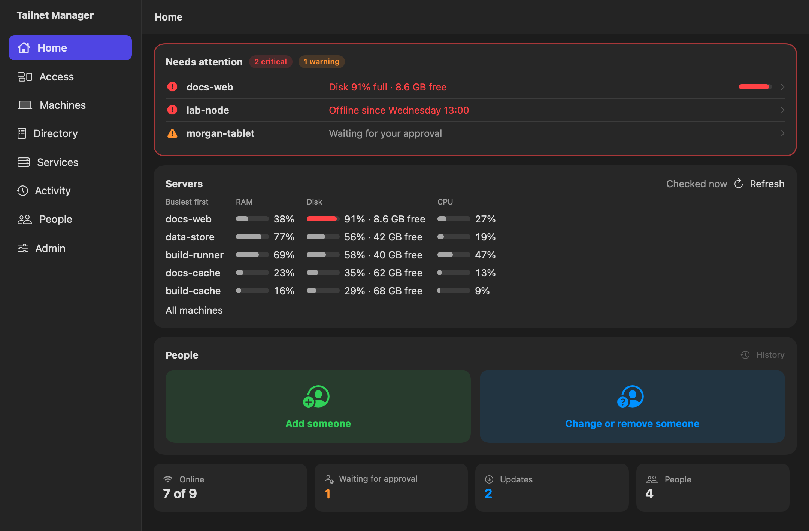
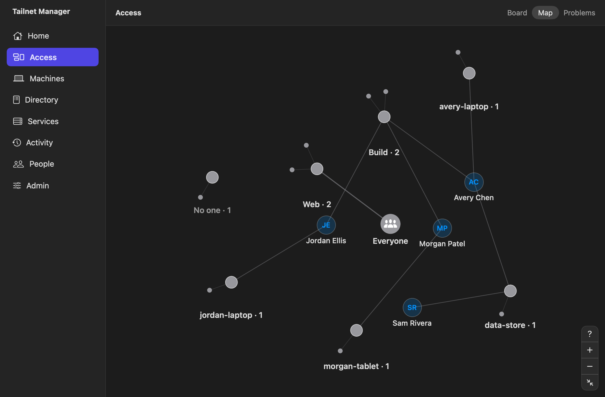

# Tailnet Manager

Tailnet Manager is an independent SwiftUI app for administering a Tailscale
network on macOS, iPhone, and iPad. It brings people, devices, and access
rules into one place so you can see who can reach which machines and review
changes before applying them.

## Screenshots

Both macOS views show a fictional tailnet.

### Home

### Access map

## What you can do

- See devices, pending approvals, expiring keys, and other items that need attention.
- Invite, pause, or remove people and review how those changes affect access.
- Read the tailnet policy as a map or table. Preview supported policy edits and keep a local backup before applying them.
- Manage device approvals, tags, route approvals, DNS settings, and auth keys. What you can read or change depends on your token's permissions.
- On macOS, use Tailscale SSH to inventory services on Linux servers you can sign in to. Review resource usage, hosted URLs, and the services behind them.

## Run locally

1. Open `TailnetManager.xcodeproj` in Xcode and run the `TailnetManager` scheme on My Mac or an iOS simulator. The deployment targets are macOS 14 and iOS 17. For a build on a physical iPhone or iPad, select your own signing team and set a bundle identifier available to your team.
2. Generate a Tailscale API access token for a test tailnet and enter it in the app. Tailnet Manager uses the [Tailscale API](https://tailscale.com/api) and stores the token in your device's Keychain.
3. For server inventory on macOS, enable Tailscale SSH on the Linux servers and grant SSH access in the tailnet policy. Set your server accounts in **Services → Scan settings** if the policy does not name specific login accounts.

Server inventories, policy backups, change history, and exported reports can
contain tailnet details. Use sample data for screenshots, issues, and pull
requests.

## Contributing

Bug reports and pull requests are welcome. A small fix, a clearer label, or
an example for an unusual policy is a good place to start. See
[CONTRIBUTING.md](CONTRIBUTING.md) for build commands, a map of the code,
and ideas for extending the app.

## License

Tailnet Manager is available under the [MIT License](LICENSE).
